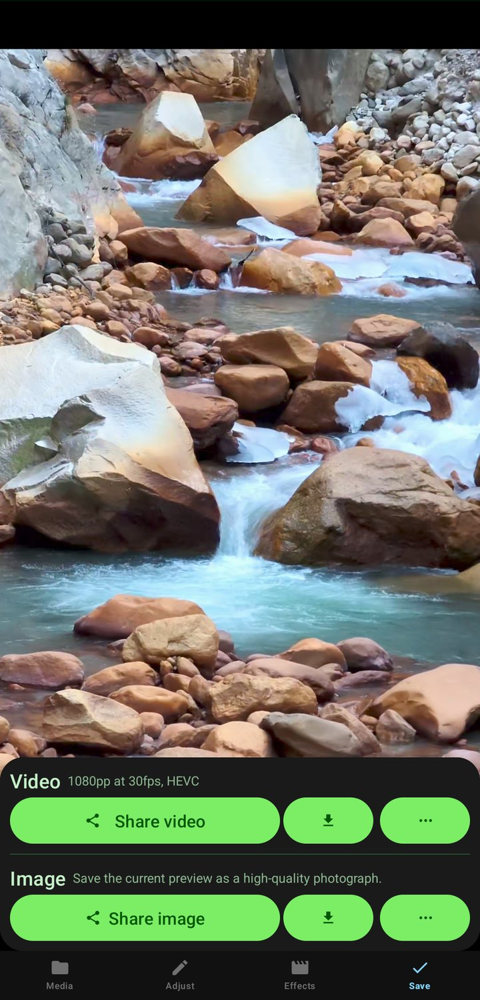
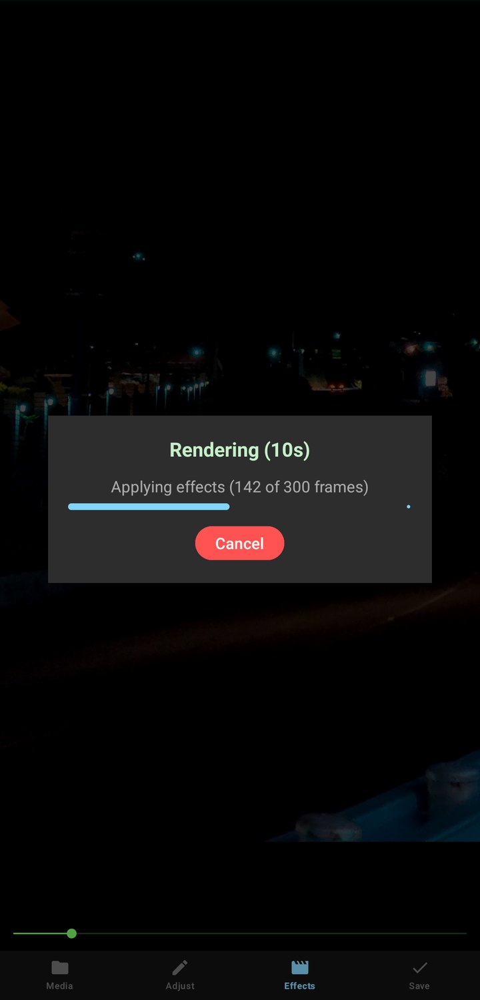

# TimeLapse

Create high-quality timelapse videos from existing videos or a series of photos (sorted alphabetically). The app blends frames over time, stabilizes shaky footage, and exports the result as a video or a still image.

In plain terms: an effect is applied across a span of N frames at once, not to each frame on its own. That is what smooths moving water, cuts noise, and gives the long-exposure look.

Version 3.0 is a major update to the UI and screens. The old single-screen layout is now four tabs: Media, Adjust, Effects, and Save.

## Download

The APK is on the [releases page](https://github.com/ksrujankanth/TimeLapse/releases/latest). Download it on the phone and open it. Android will ask you to allow installing from your browser or file manager.

Requirements: Android 10 (API 29) or newer, arm64 or armeabi-v7a.

The same page has the source archive as a zip or tar.gz. Build it with Android Studio if you want to compile it yourself.

The GIF shows a raw frame and the same clip after an average stack. The moving water smooths out and the noise drops.

  
  

**Effects** — average stack, motion blur, light trails, lighten average, long exposure (sum), HDR, median cleanup, motion extraction, transition, super resolution. Pick one, set the stack length, and apply it.

**Save** — export the rendered video or save and share the current frame as an image. FPS, bitrate, and H.265 are available when the device supports them.

  
  

**Rendering** — live progress with frame counts, cancellable at any time.

**Media** — load a video, an image sequence, or a folder. The last source can be reopened from the same screen.

  

**Mask editor** — draw over the subject you want to keep still. The mask is used during stabilization.

## Build

Open the project in Android Studio, or run:

    gradlew.bat assembleDebug

Android SDK 34 and NDK 26.1 are required. The OpenCV module is included in the repo.

For a signed release build, create a `keystore.properties` file in the project root (see `.gitignore` for the expected format) and run `gradlew.bat assembleRelease`.

## License and credits

MIT License. Credit is appreciated but not required. If you fork this or ship a modified build, a link back to [this repository](https://github.com/ksrujankanth/TimeLapse) is enough.

TimeLapse up to 1.5 was written by dan, who started the project. Versions 2.0 and later were written by [ksrujankanth](https://github.com/ksrujankanth).

The OpenCV module bundled in `opencv/` is Apache 2.0, not MIT. See [LICENSE](LICENSE) for the full text, the attribution request, and the third-party notices.
