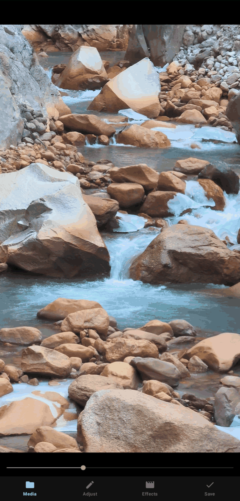
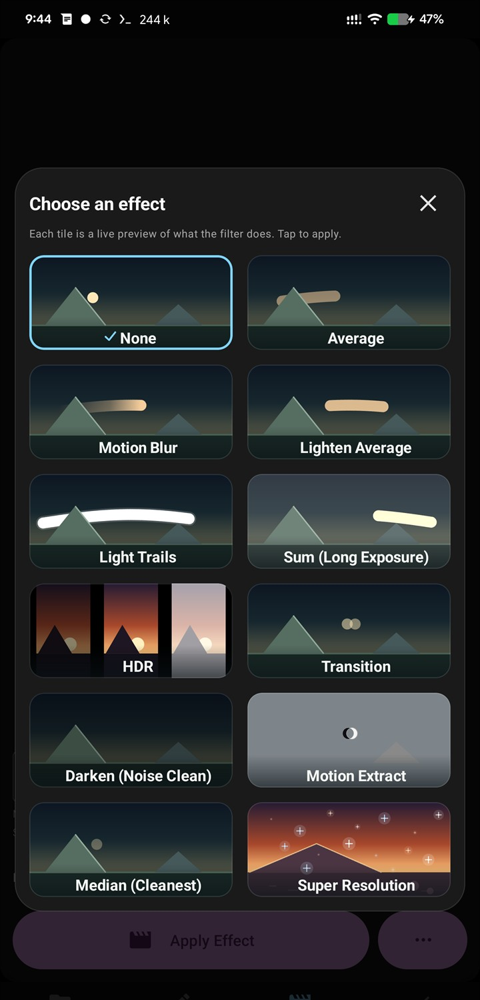
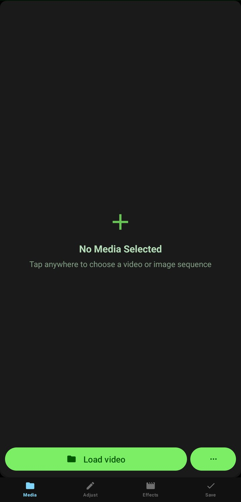
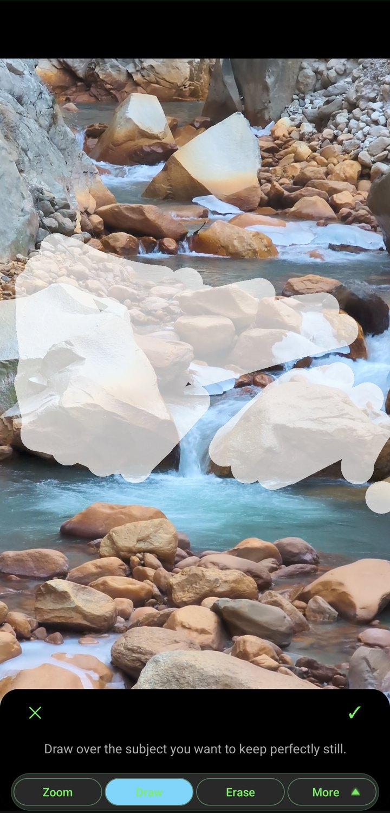

# TimeLapse

Create high-quality timelapse videos from existing videos or a series of photos. The app helps blend frames over time, stabilize shaky footage, and export the result as a video or a still image.

In plain terms: an effect is applied across a span of N frames at once, not to each frame on its own. That is what smooths moving water, cuts noise, and gives the long-exposure look.

Version 3.0 moved the app to four tabs: Media, Adjust, Effects and Save. Version 3.0.1 is a quality and reliability update.

## What's new in 3.0.1

- **Live effect previews.** The effect dropdown is now a tile sheet where every effect is shown as a short animation of what it does.
- **Better stabilization.** Smooth mode is the default; it removes jitter while keeping pans. The crop is solved automatically, so the output has no black edges, and a tripod-friendly anchor mode is still available.
- **Better super resolution.** The fusion engine now splats samples instead of blurring them together, rejects misaligned frames, adapts its sharpening to the source, and keeps at least half of a burst.
- **16-bit input and output.** Super Resolution accepts 16-bit TIFF and PNG sequences and exports a lossless 16-bit PNG.
- **Share sheet support.** Send photos, videos, or a folder to TimeLapse from Photos, Files, or any other app.
- **More reliable sessions.** Folder and multi-photo sessions reopen correctly after a restart, and large folders scan in seconds.
- **Input speed for every effect.** The Nx speed control now also decimates stacking effects, and a single unreadable frame no longer aborts a render. Moving the slider only refreshes the preview; it no longer auto-saves a file on every stop.
- **No zero-second videos.** A clip or speed setting that cannot fill a stack window is refused with a clear message instead of saving a one-frame MP4.
- **Smarter progress and time estimates.** The progress bar and the remaining time now follow the same learned phase plan, so the bar no longer races through scanning and then crawls through alignment. Loading dialogs also distinguish image header probing from full loading.
- **16 KB page-size native libraries**, required by Android 15+ and newer devices.

## Download

The APK is on the [releases page](https://github.com/ksrujankanth/TimeLapse/releases/latest). Download it on the phone and open it. Android will ask you to allow installing from your browser or file manager.

Requirements: Android 10 (API 29) or newer, arm64 or armeabi-v7a.

The GIF shows a raw frame and the same clip after an average stack. The moving water smooths out and the noise drops.

  
  

**Effects** — average stack, motion blur, light trails, lighten average, long exposure (sum), HDR, median cleanup, motion extraction, transition, super resolution. Each effect is previewed as a live animation in the picker. Pick one, set the stack length, and apply it.

**Save** — export the rendered video or save and share the current frame as an image. FPS, bitrate, and H.265 are available when the device supports them.

  
  

**Rendering** — live progress with frame counts, cancellable at any time.

**Media** — load a video, an image sequence, or a folder. The last source can be reopened from the same screen, and the app accepts media shared from other apps through the Android share sheet.

  

**Mask editor** — draw over the subject you want to keep still. The mask is used during stabilization.

## Build

Open the project in Android Studio, or run:

    gradlew.bat assembleDebug

Android SDK 34 and NDK 27.1 are required. The OpenCV module is included in the repo.

## License and credits

MIT License. Credit is appreciated but not required. If you fork this or ship a modified build, a link back to [this repository](https://github.com/ksrujankanth/TimeLapse) is enough.

TimeLapse up to 1.5 was written by dan, who started the project. Versions 2.0 and later were written by [ksrujankanth](https://github.com/ksrujankanth).

The OpenCV module bundled in `opencv/` is Apache 2.0, not MIT. See [LICENSE](LICENSE) for the full text, the attribution request, and the third-party notices.
