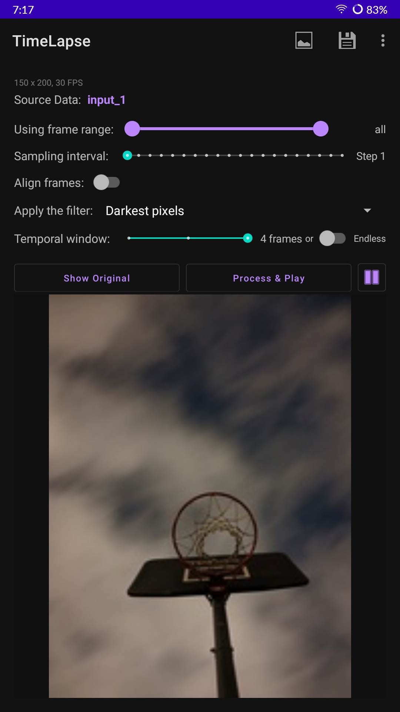
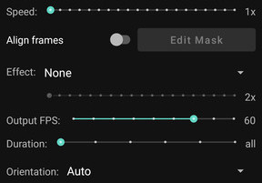
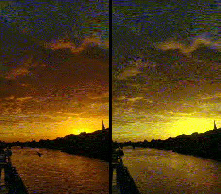
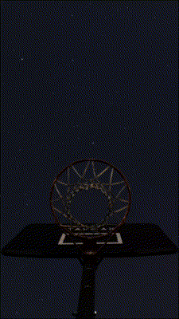
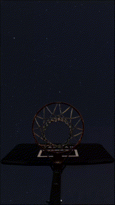

# TimeLapse

Create high-quality timelapse videos from existing videos or a series of photos (sorted alphabetically). This tool offers advanced frame-blending and stabilization techniques to produce professional results.

* [Main Screen](#main-screen)
  * [Toolbar](#toolbar)
  * [Parameters](#parameters)
  * [Processing & Playback](#processing--playback)
* [Advanced Effects](#advanced-effects)
  * [Smoothing & Stacking](#smoothing--stacking)
  * [Transitions](#transitions)
  * [Creative Filters](#creative-filters)

## Main Screen

The app features a dual-mode interface (General/Expert) to cater to both beginners and experts (in terms of terms, no functionality change).

### Toolbar
Located at the top right:
* **Open Media**: Import a video file or a sequence of images.
* **Save**: Export your processed timelapse to your gallery.
* **Menu (⋮)**: 
  * Open Image Series/Folders
  * Save current frame as a full-size image
  * Settings (toggle Expert mode, output format, etc.)

### Parameters

* **Frame Range / Trim**: Use the range slider to precisely select the start and end points of your source data.
* **Sampling Interval / Speed**: Choose how many frames to skip. "Step 1" uses every frame; higher steps increase the speed of the final video.
* **Align Frames / Stabilize**: Correct camera shake. Supports an **Edit Mask** feature to exclude moving objects (like clouds or people) from the alignment process.
* **Filters & Effects**: Apply advanced algorithms like Median Stack (for noise reduction), HDR, or Motion Extraction.
* **Temporal Window / Smoothness**: Define how many consecutive frames are blended together. Enable **Endless** for cumulative effects like light trails.

### Processing & Playback
* **Show Original**: Preview the source media without any effects.
* **Process & Play**: Renders the timelapse with selected parameters and starts playback.
* **Pause/Stop**: Halt playback at any time.

## Advanced Effects

### Smoothing & Stacking
Reduce noise and create silky-smooth motion by averaging multiple frames.
Original (left) vs. Smooth 10x (right):

### Transitions
Seamlessly blend images together using intelligent cropping and transition algorithms.
Input 1 | Input 2 | Input 3 | Input 4
-- | -- | -- | --
 |  |  | 

### Creative Filters
From "Darkest Pixels" for moody skies to "Lightest Pixels" for star trails.
Normal | Endless Lightest Pixels (Star Trails)
-- | --
 | 

--- 

### Future roadmap is to first overhaul the UI and add sigma filtering (lucky imaging) and super high-res extraction.
---

Also a huge Thanks to the original developer dan for building the base and google's AI tools for helping me build over it.
